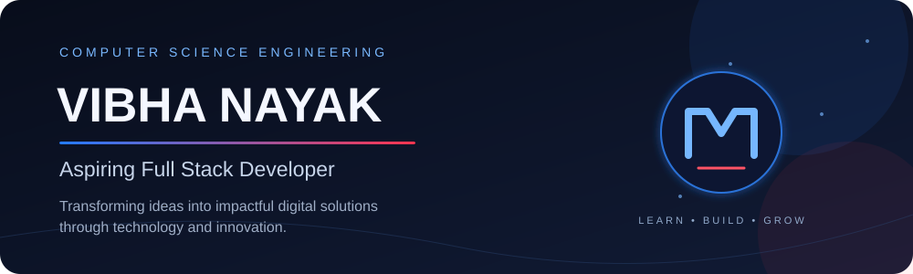
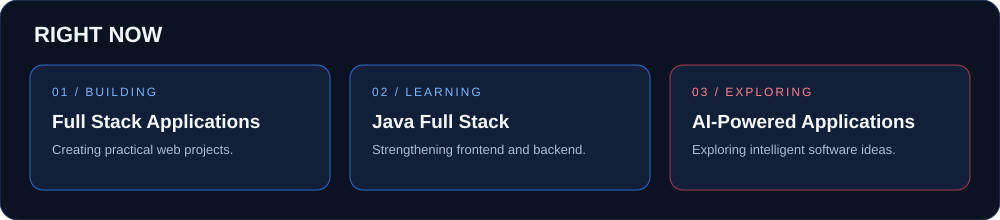
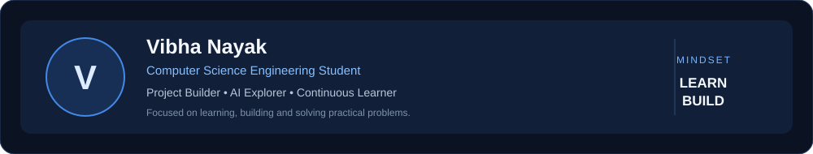

 

---

## About Me

I'm a Computer Science Engineering student working toward becoming a Full Stack Developer. I enjoy turning ideas into practical applications, learning new technologies, and exploring how AI can support useful software solutions.

- Currently learning **Java Full Stack Development**
- Building and improving **web application projects**
- Exploring **AI-powered applications** and software solutions
- Interested in continuous learning, collaboration, and problem-solving

## Tech Stack

| Area | Technologies |
|---|---|
| Programming | C, Python, Core Java |
| Frontend | HTML, CSS, JavaScript |
| Backend | Java Full Stack |
| Database | MySQL |
| Development Tool | Visual Studio Code |

## Featured Projects

### More Projects

| Project | Description | Repository |
|---|---|---|
| **CHURN_ANALYSIS** | Customer churn analysis project. | [View repository](https://github.com/vibharnayak/CHURN_ANALYSIS) |
| **RAGPDF** | PDF question-answering project using a retrieval-augmented generation approach, as described in its repository. | [View repository](https://github.com/vibharnayak/RAGPDF) |
| **PORTFOLIO** | Personal portfolio website. | [View repository](https://github.com/vibharnayak/PORTFOLIO) |

## Developer Snapshot

## Let's Connect

<a href="https://github.com/vibharnayak">GitHub</a> ·
<a href="https://www.linkedin.com/in/vibha-nayak-b97a59405/">LinkedIn</a>

  

Learning continuously. Building thoughtfully. Improving with every project.

